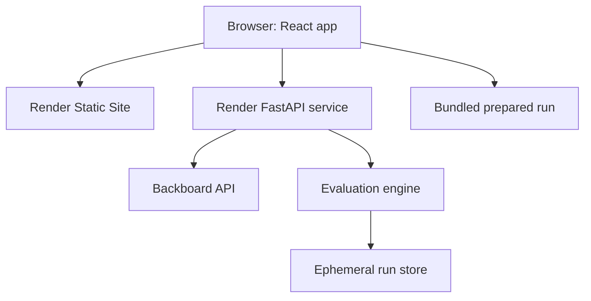

# CaseHop Engineering Handoff

## 1. Document Control and Sources

| Field | Locked value |
|---|---|
| Project | CaseHop |
| Status | Approved engineering blueprint; ready for controlled execution |
| Date | 17 October 2026 |
| Owner | `kernelKain`, solo builder |
| Repository | `git@github.com:kernelKain/casehop.git` |
| Local path | `/home/kernel-kain/Documents/Github/casehop` |
| Starting branch | `main` at commit `22a1420` |
| Starting state | `README.md`, `LICENSE`, and untracked `docs/HANDOFF_0.md`; no application code |
| Build capacity | 20 realistic hours |
| Feature freeze | 18 October 2026, 8:00 PM IST |
| Submission deadline | 19 October 2026, 12:29 PM IST |
| Prompt 2 authority | A1 |
| Budget | Existing $5 Backboard balance; no automatic reload or additional spending |
| Data policy | Synthetic demonstration data only |

### Source-of-truth order

1. Latest explicit user decision concerning execution authority or approval
2. Current official challenge rules
3. Locked Prompt 0 product contract
4. This engineering handoff
5. Actual repository and runtime evidence
6. Recorded execution state
7. Explicit assumptions and `VERIFY-EARLY` items

### Material sources

| Source | Execution consequence |
|---|---|
| https://dev.to/challenges/hacktoberfest-week2-2026-10-12 | New project, open-source AI at its core, Side Hustle theme, DEV post, required tags, deadline, judging criteria, and partner-category requirements. :chatgpt-content-reference{index="1"} |
| https://dev.to/challenges/hf26 | Confirms one submission per challenge and that partner categories must be genuinely used. :chatgpt-content-reference{index="2"} |
| https://docs.backboard.io/concepts/messages | Backboard supports per-request provider/model selection, `system_prompt`, `json_output`, memory-off operation, token telemetry, and OpenRouter routing. :chatgpt-content-reference{index="3"} |
| https://docs.backboard.io/concepts/billing | Balance and recent-usage endpoints expose token counts and deducted USD amounts. :chatgpt-content-reference{index="4"} |
| https://render.com/docs/free | Free Web Services spin down after 15 minutes and have ephemeral filesystems; durable application state cannot depend on local disk. :chatgpt-content-reference{index="5"} |
| https://docs.entire.io/quickstart | Entire can capture agent sessions and connect them to Git commits. :chatgpt-content-reference{index="6"} |
| https://docs.entire.io/agents/codex | Entire’s Codex hooks capture prompts, turns, changed files, tool calls, and subagent events. :chatgpt-content-reference{index="7"} |
| https://docs.github.com/en/copilot/how-tos/use-copilot-agents/use-code-review | Copilot can review a pull request and produce severity-labelled findings and suggested changes. :chatgpt-content-reference{index="8"} |

Prompt 1 performed planning and read-only inspection only. It did not create files, install dependencies, run builds or tests, call Backboard with credentials, change Git, deploy, or verify runtime behavior.

---

## 2. Locked Product Contract

### Product

**CaseHop — Switch models with confidence.**

CaseHop compares the model behind a small SaaS’s structured-output feature with two open-weight alternatives using the team’s reviewed application cases. It exposes consequential failures, preserves uncertainty, produces a limited TRY/HOLD/REJECT verdict, and generates a controlled Hop Plan grounded only in observed evidence.

### Target user

A founder-engineer or product engineer at a small SaaS who needs to replace an existing model because of cost, latency, deprecation, privacy, or self-hosting requirements.

### Narrow initial task

Convert synthetic customer-support messages into structured support tickets containing:

- Issue summary
- Category
- Priority
- Exact order numbers
- Missing-information flags

### Differentiator

CaseHop is not a generic benchmark dashboard. It maintains a task-specific contract consisting of reviewed cases, approved outcomes, must-preserve facts, forbidden behavior, human-review decisions, run evidence, verdict thresholds, and an evidence-bound switch plan.

### Primary categories

- **Side Hustle:** A specific workflow that a small SaaS could pay for, with open-weight models performing the actual application task.
- **Best Use of Render:** Render hosts the public frontend and evaluation backend.
- **Best Use of Backboard:** Backboard provides one API through which the baseline and two open-weight candidates are evaluated.

### Conditional categories

- **Best Use of Entire:** Enter only if at least one important implementation decision has a public, scrubbed Entire session/checkpoint linked in the write-up.
- **Best Use of GitHub Copilot:** Enter only if Copilot reviews a real pull request, identifies a material issue, and the resulting fix is documented.
- If either proof is missing, omit that category without delaying the core submission.

### Locked Hook

A candidate appears attractive until CaseHop shows:

- Source fact: `A-1847`
- Candidate output: `A-1841`
- Failure: critical must-preserve fact mutation
- Verdict: **REJECT**

A second open candidate preserves the evidence, earns **TRY**, and receives a controlled Hop Plan.

The final demonstration may use this example only if the output came from an actual recorded model run. Fixture data must be labelled as fixture data and cannot be presented as live evidence.

### Judge demo path

```text
Landing page
→ open the prepared 30-case Case Pack
→ compare one baseline and two open candidates
→ inspect the A-1847/A-1841 failure before aggregate scores
→ resolve any ambiguous human-review items
→ view TRY/HOLD/REJECT verdicts
→ select the TRY candidate
→ inspect and download its evidence-bound Hop Plan
```

### Decisions Prompt 2 may not silently change

- Product name or target user
- Support-ticket extraction task
- One baseline plus two open candidates
- Approximately 30 reviewed cases
- Requirement-level evidence and human review
- Evidence-first failure presentation
- TRY/HOLD/REJECT vocabulary
- Exact locked Hook
- Backboard’s role as the model gateway
- Render’s role as public host
- No authentication, billing, automatic migration, fine-tuning, or production-safety claim
- No claim that 30 cases prove production readiness

---

## 3. Scope and Acceptance

### MUST

- Premium public landing page with an immediately understandable promise
- One bundled synthetic 30-case support-ticket Case Pack
- One baseline model and two open-weight candidates
- Same task contract and case inputs for every model
- Backboard integration with memory and web search disabled
- Exact checks for must-preserve facts, schema, category, and missing-information behavior
- Human review for ambiguous semantic outcomes
- Individual failures shown before aggregate metrics
- End-to-end latency and available cost evidence
- Unknown values explicitly shown as unknown
- TRY/HOLD/REJECT verdicts with reasons
- Deterministic evidence-bound Hop Plan
- Downloadable Case Pack and Model Decision Report
- Prepared fallback run and at least one live open-model demonstration
- Render deployment
- Synthetic-data and limited-evidence disclosures
- Responsive and keyboard-accessible primary journey
- README, architecture explanation, demo script, screenshots, and DEV submission copy

### SHOULD

- Comparison-history summary for the current browser session
- Additional failure filters
- JSON and Markdown report exports
- Shareable report URL while the backend run remains available
- Entire checkpoint/session evidence
- Material Copilot review evidence
- Warm-up status for Render cold starts

### POST-HACKATHON

- Arbitrary application types
- User accounts, authentication, billing, or teams
- Persistent evaluation history
- Production data ingestion
- Automatic code changes or migration
- CI-based recurring evaluations
- Model fine-tuning
- Broad provider coverage
- Prompt or agent evaluation
- Public benchmark libraries
- Production certification
- Multiple Case Pack templates

### Non-goals

- Selecting a universally “best” model
- Claiming statistical certainty from 30 cases
- Guaranteeing production safety
- Guaranteeing cost savings
- Running private customer data through a public demo
- Automatically switching a production model
- Generating unreviewed migration code

### Acceptance criteria

| ID | Observable criterion |
|---|---|
| AC-01 | A new visitor understands the user, problem, and primary action within ten seconds. |
| AC-02 | The prepared Case Pack contains exactly 30 synthetic, reviewed support-ticket cases with approved outcomes and explicit requirements. |
| AC-03 | One baseline and two open candidates receive the same system prompt, output contract, and case content through Backboard, with model and provider identities recorded. |
| AC-04 | A mutated or invented must-preserve order number is shown as a critical failure with source and output evidence. |
| AC-05 | Ambiguous checks enter a visible human-review queue and the reviewer’s decision changes the final evidence. |
| AC-06 | Every model receives a reasoned TRY, HOLD, or REJECT verdict without implying certification. |
| AC-07 | The report shows median and p95 end-to-end latency, token counts, available run cost, and explicit unknowns. |
| AC-08 | A TRY candidate receives a deterministic Hop Plan traceable to requirements, failures, unknowns, and tested limits. |
| AC-09 | Users can download the exact Case Pack and a Markdown or JSON Model Decision Report. |
| AC-10 | A bundled prepared run preserves the complete demo path when live inference fails, and its recorded/fixture status is unmistakable. |
| AC-11 | The public backend keeps the Backboard key server-side, accepts only bounded inputs, rate-limits runs, and never logs message bodies or secrets. |
| AC-12 | The primary journey works at 390px and 1440px widths, by keyboard, with visible focus and WCAG AA contrast. |
| AC-13 | Backboard genuinely performs the model calls and supplies model, token, and available billing evidence. |
| AC-14 | The frontend and API are publicly reachable on Render, with a verified health route and documented cold-start behavior. |
| AC-15 | Entire is claimed only if a scrubbed session or checkpoint documenting an important decision is publicly accessible. |
| AC-16 | GitHub Copilot is claimed only if a material review finding and its resulting fix are both visible. |
| AC-17 | The repository and DEV submission explain who would pay, why open models matter, limitations, architecture, setup, demo, and category proof. |

### Traceability

| Acceptance ID | Requirement or value | Implemented in | Verified by | Demo proof |
|---|---|---|---|---|
| AC-01 | Immediate clarity | VF-01, UR-01 | Browser review | Landing page |
| AC-02 | Reviewed Case Pack | FE-01, OQ-01 | Schema and fixture tests | Case Pack summary |
| AC-03 | Fair comparison | BF-01, CW-01, CW-02 | Provider-contract tests and pilot | Run manifest |
| AC-04 | Hook and factual safety | BF-01, OQ-01 | Critical-fact regression | Evidence diff |
| AC-05 | Human judgment | FE-03, CW-02 | Component and API tests | Review queue |
| AC-06 | Evidence-limited verdict | BF-01, OQ-01 | Verdict-table tests | Verdict cards |
| AC-07 | Measurements and unknowns | CW-01, CW-02 | Integration tests | Metrics table |
| AC-08 | Grounded Hop Plan | FE-03, OQ-02 | Traceability tests | Hop Plan |
| AC-09 | Repeatability | BF-02, OQ-02 | Export snapshot tests | Downloads |
| AC-10 | Honest fallback | VF-01, IH-01 | Offline E2E test | Prepared-run banner |
| AC-11 | Security and budget | BF-02, IH-01 | Abuse and secret checks | Public demo controls |
| AC-12 | UX quality | UR-01, IH-01 | Playwright, axe, manual review | Mobile/desktop demo |
| AC-13 | Backboard | CW-01, CW-02 | Live pilot and usage evidence | Provider evidence panel |
| AC-14 | Render | SF-03, IH-01 | Health and smoke checks | Public URLs |
| AC-15 | Entire | SF-02, DS-02 | Public-link check | Write-up evidence |
| AC-16 | Copilot | Integration Hardening gate | PR review and fix evidence | Write-up evidence |
| AC-17 | Submission quality | DS-01, DS-02 | Final audit | DEV post |

---

## 4. UX and Frontend Contract

### First-impression goal

Within ten seconds, a visitor should understand:

> Public benchmarks rank models. CaseHop shows whether one can do your job without corrupting the facts your app depends on.

Primary CTA: **Open the prepared Case Pack**

Secondary CTA: **See the failure CaseHop catches**

### Visual direction

A precise “model decision lab,” not a generic AI dashboard.

| Token | Direction |
|---|---|
| Background | Warm off-white `#F4F1E8` |
| Primary surface | White with thin ink borders |
| Primary text | Near-black `#171916` |
| Muted text | Slate `#5E655F` |
| Brand accent | Electric chartreuse `#B8F34A` |
| TRY | Deep green |
| HOLD | Amber |
| REJECT | Vermilion red |
| Information | Cobalt |
| Radius | 12–18px; avoid excessive pill styling |
| Shadow | Sparse, low-blur, used only for elevation |
| Typography | Space Grotesk or equivalent local package for display; system sans for body; monospace for facts and model IDs |
| Motion | Short functional transitions; disabled under reduced-motion preference |

Create a compact CaseHop mark from two offset case cards and a forward “hop” arrow. Use an original SVG committed to the repository.

### Information architecture

| Route | Purpose |
|---|---|
| `/` | Product promise, Hook preview, process, commercial relevance, categories |
| `/workspace` | Four-stage evaluation workspace |
| `/report/:runId` | Evidence, verdicts, selected candidate, exports |
| `/method` | Fairness rules, verdict thresholds, limitations, privacy |

### Workspace stages

1. **Case Pack**
   - Task contract
   - 30-case coverage summary
   - Requirements
   - Inspectable case list
   - JSON import validation for local use
2. **Run**
   - Baseline/candidate lineup
   - Prepared or live mode indicator
   - Progress by model and case
   - Cost guard and balance-safe messaging
3. **Evidence**
   - Critical failures first
   - Requirement matrix
   - Side-by-side source/output evidence
   - Human-review queue
   - Latency, tokens, cost, and unknowns
4. **Hop Plan**
   - Available only for a selected TRY candidate
   - Tested scope
   - Limitations
   - Controlled trial
   - Verification gates
   - Rollback triggers
   - Download actions

### Primary interaction behavior

- The prepared Case Pack is preselected.
- Opening it shows its requirements before any aggregate number.
- “Run comparison” offers:
  - **Prepared evidence:** instant, labelled recorded fixture
  - **Live verification:** bounded Backboard run when enabled
- Evidence defaults to critical failures rather than a leaderboard.
- Selecting the A-1847 case pins the source message and highlights the changed substring.
- Verdicts always include the rule that triggered them.
- Choosing a TRY candidate unlocks the Hop Plan.
- The final CTA downloads the report and Case Pack.

### Responsive rules

- `≥1200px`: two-column workspace with persistent stage rail and evidence panel.
- `768–1199px`: collapsible stage rail; comparison table remains horizontally scrollable with sticky model headers.
- `<768px`: stages become a top stepper; evidence becomes stacked cards; source and output remain adjacent vertically.
- No essential content appears only on hover.
- Data tables receive labelled card alternatives on narrow screens.

### Component rules

Reusable components:

- App shell and stage navigation
- CaseHop logo
- Hero evidence card
- Model identity badge
- Verdict badge
- Requirement status
- Evidence diff
- Metric card
- Model comparison table
- Progress timeline
- Human-review card
- Disclosure banner
- Export menu
- Toast and inline error
- Skeleton and retry panel

Business rules must stay outside presentation components.

### Required states

| State | Required behavior |
|---|---|
| Loading | Skeletons matching final layout; no blank full-page spinner |
| Empty | Explain how to open the prepared Case Pack |
| Slow | Show completed/total cases and current model |
| Partial | Preserve finished results and label unavailable evidence |
| Invalid import | List schema errors without discarding the previous valid pack |
| Provider error | Identify affected model, retry option, and fallback availability |
| Cost guard | Explain why the run was stopped and retain prior evidence |
| Human review | Show why automation abstained |
| Success | Show failures first, then aggregate evidence |
| Render cold start | “Warming evaluation engine” with retry |
| Prepared fallback | Persistent “Recorded demo evidence” disclosure |

### Accessibility

- WCAG 2.1 AA contrast
- Semantic headings, landmarks, tables, and forms
- Complete keyboard operation
- Visible `:focus-visible` treatment
- Skip link
- Accessible names for icon controls
- `aria-live="polite"` for run progress
- No verdict communicated by color alone
- Reduced-motion support
- Focus moved to the first error after failed validation
- Evidence diffs include textual descriptions

### Fixture scenarios

- Happy path with one TRY, one HOLD, one REJECT
- Exact locked A-1847/A-1841 Hook
- Empty Case Pack
- Slow run
- One provider unavailable
- Malformed JSON
- Cost unavailable
- Human review unresolved
- All candidates rejected
- Render API cold start
- Prepared fallback mode

### Mock/live adapter contract

The frontend consumes one `EvaluationRun` contract regardless of source.

- `FixtureRunAdapter` loads versioned, bundled JSON.
- `ApiRunAdapter` creates and polls a live backend run.
- Both expose identical status, progress, evidence, metric, verdict, and export shapes.
- Fixture data includes `evidence_origin: "fixture"`.
- Live results include `evidence_origin: "live"`.
- Components must not contain source-specific branches beyond the disclosure label.

### UX APPROVAL GATE

After UR-01, Prompt 2 must provide:

- Preview URL or exact local command
- Landing page and complete fixture-driven journey
- Desktop and mobile screenshots
- Keyboard and accessibility results
- Every required UI state
- Known limitations
- Focused questions about clarity, visual quality, evidence presentation, and the Hook

Prompt 2 must pause for explicit approval before Backend Foundation.

---

## 5. Architecture, Stack, and Repository

### System context



### Main data flow

1. Browser loads the static React application.
2. Browser validates and displays the bundled Case Pack.
3. A live run request references the prepared pack and fixed model lineup.
4. FastAPI validates limits, budget guard, and rate limit.
5. The backend sends each case through Backboard with the same task contract.
6. The evaluation engine parses results and computes deterministic checks.
7. Ambiguous items remain unresolved until human review.
8. Verdicts and Hop Plans are derived from recorded evidence.
9. Results remain temporarily in memory and can be downloaded.
10. If the API fails, the browser loads the labelled prepared run.

### Chosen stack

| Layer | Selection | Constraint and rationale |
|---|---|---|
| Frontend runtime | Node.js 24 LTS | Stable modern runtime; lock exact dependencies |
| Frontend | React 19, TypeScript, Vite | Fits user experience, fast setup, clear component model |
| Styling | Tailwind CSS plus small token layer | Fast responsive work without a heavyweight component system |
| Icons | `lucide-react` | Accessible, consistent, lightweight |
| Validation | Zod frontend; Pydantic v2 backend | Shared conceptual schemas and clear import errors |
| Backend runtime | Python 3.12 | Stable ecosystem and user preference |
| API | FastAPI | Typed contracts, async HTTP, simple health and job APIs |
| HTTP client | `httpx` | Async Backboard calls, explicit timeout/retry control |
| Backend settings | `pydantic-settings` | Typed environment configuration |
| Storage | In-memory TTL run store | No accounts/history requirement; matches ephemeral Render constraints |
| Frontend tests | Vitest, Testing Library, Playwright | Unit/component plus focused E2E |
| Backend tests | pytest, pytest-asyncio, respx | Deterministic logic and mocked Backboard contracts |
| Quality | ESLint, TypeScript, Ruff, mypy | Fast feedback and typed boundaries |
| CI | GitHub Actions | Required checks without live secrets |
| Hosting | Render Static Site + Render Web Service | Fast landing page and meaningful Render usage |
| Model gateway | Backboard REST API | One key, model switching, billing evidence, partner-category fit |
| Session evidence | Entire CLI | Conditional category and development traceability |
| Code review | GitHub Copilot PR review | Conditional category with material evidence requirement |

Exact package versions must be pinned by `package-lock.json` and Python requirement pins during Stack Foundation. Do not perform broad upgrades after Stack Foundation.

### Material rejected alternatives

| Alternative | Why it lost |
|---|---|
| OpenRouter directly | Better direct model controls, but would duplicate or weaken the approved Backboard role |
| Next.js full stack | Adds framework and deployment complexity without product benefit |
| PostgreSQL | Persistent history is optional and Render local storage is ephemeral; database work would consume scarce time |
| Celery/Redis | Unnecessary for one bounded demo job on one process |
| PDF generation | Markdown/JSON exports meet repeatability needs with less risk |
| Full component library | Risks generic visual output and setup overhead |
| Single Docker service | Simpler origin model, but forces the landing page behind Render’s free-service cold start |
| Local inference on Render | Free CPU/RAM is unsuitable for the selected model sizes |

### Planned repository structure

```text
casehop/
├── .entire/
├── .github/
│   ├── workflows/ci.yml
│   └── copilot-instructions.md
├── backend/
│   ├── app/
│   │   ├── api/
│   │   ├── core/
│   │   ├── domain/
│   │   ├── providers/
│   │   ├── services/
│   │   └── main.py
│   ├── tests/
│   ├── requirements.txt
│   └── requirements-dev.txt
├── frontend/
│   ├── public/
│   ├── src/
│   │   ├── adapters/
│   │   ├── assets/
│   │   ├── components/
│   │   ├── data/
│   │   ├── features/
│   │   ├── pages/
│   │   ├── schemas/
│   │   ├── styles/
│   │   └── test/
│   ├── e2e/
│   ├── package.json
│   └── package-lock.json
├── docs/
│   ├── HANDOFF_0.md
│   ├── HANDOFF.md
│   ├── EXECUTION_STATE.md
│   ├── architecture.md
│   ├── demo-runbook.md
│   └── submission-draft.md
├── scripts/
│   ├── smoke_api.py
│   └── verify_casepack.py
├── .env.example
├── .gitignore
├── render.yaml
├── LICENSE
└── README.md
```

### Environment variables

| Variable | Location | Purpose |
|---|---|---|
| `BACKBOARD_API_KEY` | Backend only | Backboard authentication |
| `CASEHOP_MODE` | Backend | `fixture`, `live`, or `hybrid` |
| `CASEHOP_MODEL_BASELINE` | Backend | Baseline model |
| `CASEHOP_MODEL_CANDIDATE_A` | Backend | First candidate |
| `CASEHOP_MODEL_CANDIDATE_B` | Backend | Second candidate |
| `CASEHOP_MIN_BALANCE_USD` | Backend | Stop before exhausting credits |
| `CASEHOP_MAX_CONCURRENT_CALLS` | Backend | Bounded provider concurrency |
| `CASEHOP_RUN_TTL_SECONDS` | Backend | Ephemeral result lifetime |
| `CASEHOP_ALLOWED_ORIGINS` | Backend | Render frontend origin |
| `CASEHOP_ALLOW_CUSTOM_PACKS` | Backend | `false` on public demo |
| `VITE_API_BASE_URL` | Frontend build | Public backend origin |

No real `.env` file may be committed.

### CI architecture

CI runs without Backboard or Render credentials:

- Frontend lint, type check, unit tests, and build
- Backend Ruff, formatting check, mypy, and pytest
- Case Pack schema verification
- Prepared-run fixture validation
- Playwright fixture-mode primary journey
- Secret-pattern scan of tracked files

Live provider and production smoke tests are manual gates.

### Existing-repository preservation

- Preserve the initial commit.
- Preserve `LICENSE`.
- Treat untracked `docs/HANDOFF_0.md` as user work.
- Verify it matches the approved packet before committing it.
- Do not rewrite history, force-push, amend, or squash phase commits.
- Merge phases using a merge commit so step commits remain visible.

---

## 6. Contracts, Data, and Integrations

### Case Pack

| Object | Required fields |
|---|---|
| `CasePack` | `id`, `version`, `name`, `task`, `schema_version`, `requirements`, `cases` |
| `Case` | `id`, `input_message`, `approved_output`, `must_preserve`, `forbidden_behaviors`, `review_notes` |
| `ApprovedOutput` | `issue_summary`, `category`, `priority`, `order_numbers`, `missing_fields` |
| `Requirement` | `id`, `name`, `severity`, `check_type`, `threshold`, `description` |

Case messages and approved outputs must be synthetic and original.

### Evaluation records

| Object | Purpose |
|---|---|
| `ModelTarget` | Role, display name, provider, exact model ID |
| `ModelOutput` | Raw text, parsed value, provider/model identity, latency, token counts |
| `CheckResult` | Requirement, pass/fail/review/unknown, severity, evidence |
| `ReviewDecision` | Reviewer outcome and note for one ambiguous check |
| `ModelSummary` | Requirement rates, failure counts, latency, tokens, cost, unknowns |
| `Verdict` | TRY/HOLD/REJECT, triggered rules, limitations |
| `HopPlan` | Evidence-bound controlled trial and rollback plan |
| `EvaluationRun` | Pack version, models, origin, status, evidence, reviews, summaries |

### API contracts

| Method and path | Behavior |
|---|---|
| `GET /api/v1/health` | Status, application version, mode, provider-configured boolean |
| `GET /api/v1/config` | Public model roles, limits, and feature flags; no secrets or balances |
| `GET /api/v1/case-packs/support-routing-v1` | Prepared synthetic Case Pack |
| `GET /api/v1/prepared-run` | Labelled fixture run |
| `POST /api/v1/runs` | Start bounded prepared-pack live run |
| `GET /api/v1/runs/{run_id}` | Status, progress, results, and errors |
| `POST /api/v1/runs/{run_id}/reviews` | Record bounded human-review decisions |
| `GET /api/v1/runs/{run_id}/report.md` | Download Markdown report |
| `GET /api/v1/runs/{run_id}/report.json` | Download machine-readable report |
| `GET /api/v1/runs/{run_id}/case-pack.json` | Download exact repeatable pack |

Public deployment accepts only the bundled Case Pack ID. Arbitrary live prompts remain disabled.

### Model targets

Initial target lineup:

| Role | Backboard provider | Model |
|---|---|---|
| Current-model baseline | `openai` | `gpt-4o` |
| Open candidate A | `openrouter` | `qwen/qwen3-32b` |
| Open candidate B | `openrouter` | `deepseek/deepseek-chat-v3.1` |

Backboard’s documented default is `gpt-4o`, and its examples explicitly show OpenRouter model selection. OpenRouter lists both candidate slugs and structured-output support. :chatgpt-content-reference{index="9"}

### Candidate fallback order

If a target is absent, unstable, or fails JSON output during the pilot:

1. Another verified open-weight model in Backboard’s live catalog with JSON-object output
2. `meta-llama/llama-3.3-70b-instruct`, if available
3. A smaller verified Qwen or Mistral instruct model
4. Prepared recorded evidence, clearly labelled, while retaining at least one live open candidate

Changing to a fallback within this ordered policy is allowed only during CW-01 and must be recorded in `docs/EXECUTION_STATE.md`.

### Fair-run policy

For every model and case:

- Same system prompt and JSON contract
- Same case content
- `memory: "off"`
- `web_search: "off"`
- `json_output: true`
- No tools, RAG, or extra context
- New isolated thread for each case
- Same output-token budget where supported
- Backboard/OpenRouter routing recorded
- No silent output repair
- Parsing failure counts as a format failure
- Retry only transient transport or provider failures, never a completed bad answer
- Maximum two attempts with bounded exponential backoff
- End-to-end latency measured at the backend
- Sampling controls not exposed by Backboard are disclosed as a limitation

### Automatic checks

| Check | Method |
|---|---|
| Schema | Pydantic validation |
| Order-number preservation | Exact normalized set equality |
| Invented order number | Output set minus source/approved set |
| Category | Exact enum and approved category match |
| Priority | Exact approved value |
| Missing fields | Set comparison |
| Forbidden behavior | Deterministic predicates |
| Issue-summary equivalence | Human review unless strict required phrases establish a pass/fail |
| Provider failure | Unknown, not quality failure |

### Verdict policy

**REJECT** when any of these occurs:

- Mutated or invented critical must-preserve fact
- Explicit forbidden behavior
- Critical requirement failure
- Severe schema reliability below the locked minimum

**HOLD** when:

- No critical failure exists, but human review remains unresolved
- Any required quality threshold is below TRY
- A supplied hard cost or latency limit cannot be verified
- Evidence is incomplete or materially inconsistent

**TRY** when:

- Zero critical fact or forbidden-behavior failures
- 100% parseable structured outputs for the 30-case pack
- At least 90% category and missing-information accuracy
- Every ambiguous item is reviewed
- No supplied hard limit is exceeded
- The verdict displays “limited to this 30-case test”

These verdicts are test gates, not production certification.

### Cost evidence

- Record Backboard token telemetry per response.
- Query billing balance before and after an isolated run.
- Query recent usage for the run time window and model names.
- Display per-model cost only when usage events correlate without ambiguity.
- Otherwise display total observed run-cost delta and mark allocation unknown.
- Never expose the account balance.
- Stop before the configured minimum balance.
- No auto-reload or additional purchase is authorized.

### Hop Plan generation

The Hop Plan is deterministic, not LLM-generated.

It must include:

- Candidate and tested model ID
- Tested Case Pack version
- Requirements passed
- Failures and reviewed ambiguities
- Latency/cost evidence and unknowns
- Untested behavior
- Shadow-mode trial scope
- Verification sample size
- Monitoring conditions
- Rollback triggers
- Rollback action
- Conditions required before wider adoption

Every claim links to one or more check IDs or run measurements.

### Authentication and authorization

None in the hackathon build.

Compensating controls:

- Public deployment accepts only the prepared Case Pack
- Fixed server-side model allowlist
- Global and per-IP rate limits
- One active live run at a time
- Bounded concurrency
- Input size and case-count limits
- Backboard balance floor
- No arbitrary system prompts or model IDs

### Sponsor integrations

| Sponsor | Material use |
|---|---|
| Backboard | Performs all model calls and supplies token/billing evidence |
| Render | Hosts both public frontend and evaluation backend |
| Entire | Captures important Prompt 2 agent sessions and links them to commits |
| GitHub Copilot | Reviews a real PR; category entered only if a material finding produces a documented fix |

### Integration fallbacks

| Failure | Fallback |
|---|---|
| One candidate unavailable | Use approved candidate fallback and record it |
| Multiple models unavailable | Prepared run plus at least one live open candidate |
| Billing allocation ambiguous | Total run delta or unknown |
| Render backend cold | Frontend loads prepared run and offers retry |
| Render unavailable | Local demonstration; withdraw Render category |
| Entire unavailable | Continue build; omit Entire category |
| Copilot unavailable/no material finding | Continue build; omit Copilot category |
| Hook not reproduced by an actual run | Stop and return to Prompt 0; never fabricate evidence |

---

## 7. Security, Privacy, and Reliability

### Trust boundaries

- Browser content is untrusted.
- FastAPI is the only component permitted to access the Backboard key.
- Backboard receives only synthetic prepared cases in public mode.
- Render environment variables contain secrets.
- Fixture data is public and non-sensitive.
- Entire and Copilot evidence must be scrubbed before sharing.

### Controls

- Strict Pydantic and Zod validation
- Maximum 30 cases
- Maximum 2,000 characters per message
- Fixed enums and model allowlist
- Fixed system prompt stored server-side
- Request body size limit
- CORS restricted to the Render frontend
- Backend timeouts and cancellation
- No raw message bodies in logs
- No secret values in error responses
- Rate limiting and one global live-run semaphore
- Balance floor and no auto-reload
- Content Security Policy on frontend
- Security headers on backend
- Dependency lockfiles
- Synthetic-only warning beside import/run controls

### Failure behavior

| Failure | Behavior |
|---|---|
| Timeout | Retry once if no completed response; otherwise mark unknown |
| 429 | Honor bounded delay; mark provider unavailable after retry |
| 5xx | Retry once; retain completed model results |
| Invalid JSON | Record schema failure; never silently repair |
| Job restart/loss | Return expired status and offer prepared run |
| Billing endpoint failure | Preserve quality evidence; mark cost unknown |
| Partial model run | Present partial results without cross-model winner claim |
| Browser refresh | Recover fixture state and current run ID from session storage |
| Render restart | Live runs may expire; prepared run remains available |

### Observability

Structured logs may contain:

- Request/run ID
- Model role and model ID
- Case ID
- Attempt number
- Status
- Duration
- Token totals
- Error class
- Verdict transition

Logs must not contain:

- Backboard key
- Full prompts
- Raw support messages
- Raw model output
- Account balance
- Entire transcripts

Health and readiness routes must not call Backboard.

---

## 8. Testing and Deployment

### Test layers

| Layer | Coverage |
|---|---|
| Domain unit tests | Fact extraction, set comparison, thresholds, verdicts, Hop Plan traceability |
| Schema tests | Valid and malformed Case Packs and outputs |
| Provider contract tests | Backboard requests and responses using `respx` |
| API tests | Runs, polling, review, exports, expiry, errors |
| Component tests | Workspace stages, evidence diff, verdicts, disclosures |
| E2E tests | Prepared primary journey, failure path, mobile flow |
| Live pilot | Three cases across all three models |
| Manual | Visual quality, keyboard, screen sizes, cold start, demo timing |

### Local setup commands for Prompt 2

Run separately from the repository root:

```bash
python3 --version
```

```bash
node --version
```

```bash
npm --version
```

```bash
python3 -m venv .venv
```

```bash
./.venv/bin/python -m pip install -r backend/requirements-dev.txt
```

```bash
npm --prefix frontend ci
```

### Quality commands

```bash
./.venv/bin/python -m ruff check backend
```

```bash
./.venv/bin/python -m ruff format --check backend
```

```bash
./.venv/bin/python -m mypy backend/app
```

```bash
./.venv/bin/python -m pytest backend/tests -q
```

```bash
./.venv/bin/python scripts/verify_casepack.py
```

```bash
npm --prefix frontend run lint
```

```bash
npm --prefix frontend run typecheck
```

```bash
npm --prefix frontend run test -- --run
```

```bash
npm --prefix frontend run build
```

```bash
npm --prefix frontend run test:e2e
```

### Quality thresholds

- All required tests pass
- No Ruff, ESLint, or TypeScript errors
- At least 90% branch coverage for verdict and critical-fact logic
- No uncaught browser-console errors on the primary journey
- Zero axe critical or serious violations
- Landing page usable before backend wakes
- Prepared journey completes without network access
- No committed secret or real `.env`
- No critical Lighthouse accessibility failure
- Primary demo rehearsed under 60 seconds

### Environment and migration

There is no database and therefore no schema migration.

Run state is ephemeral and expires. Exports are the supported persistence mechanism.

### Render deployment

`render.yaml` defines:

1. `casehop-web`: Static Site built from `frontend`
2. `casehop-api`: Python Web Service built from `backend`

Deployment requirements:

- Free or existing-credit plans only
- `BACKBOARD_API_KEY` configured only on the API service
- Frontend origin added to `CASEHOP_ALLOWED_ORIGINS`
- `VITE_API_BASE_URL` set to the API URL
- Health check path `/api/v1/health`
- One API process
- No persistent disk
- Public custom data disabled
- Auto-deploy may be enabled only after final branch integration

Render free services may cold-start and lose local state; the prepared run is therefore bundled into the static frontend. :chatgpt-content-reference{index="10"}

### Smoke checks

```bash
curl -fsS "$CASEHOP_API_URL/api/v1/health"
```

```bash
curl -fsS "$CASEHOP_API_URL/api/v1/config"
```

```bash
curl -fsS "$CASEHOP_WEB_URL"
```

Then complete the prepared journey in a clean browser session and run one authorized live verification.

### Rollback

- Render: roll back to one of the two previous deploys.
- Git: revert the exact offending commit; never rewrite shared history.
- Provider: disable live mode and serve prepared evidence.
- Candidate: use the approved fallback only during the allowed verification gate.
- Category: withdraw any category whose proof is no longer valid.

### Clean-clone verification

Use a fresh temporary directory, not the working repository:

```bash
git clone git@github.com:kernelKain/casehop.git casehop-clean
```

```bash
cd casehop-clean
```

Then follow only `README.md`. Both local servers, fixture tests, production builds, and the prepared journey must work.

Prompt 1 did not run any setup, build, test, provider, or deployment command. All remain unverified until Prompt 2 records actual output.

---

## 9. Demo and Submission

### Timed 60-second demo

| Time | Demo action |
|---|---|
| 0–8s | “A support SaaS wants to replace an expensive model, but generic benchmarks cannot tell it whether customer facts survive.” |
| 8–16s | Open the 30-case Case Pack and show the baseline plus two open candidates. |
| 16–28s | Open the critical evidence card: `A-1847` became `A-1841`; show the requirement failure and REJECT verdict. |
| 28–38s | Switch to the other open candidate; show preserved facts, resolved review, measurements, and TRY. |
| 38–49s | Select the candidate and show tested scope, limitations, trial gates, and rollback triggers in the Hop Plan. |
| 49–55s | Show Backboard model evidence and the public Render URLs. |
| 55–60s | “CaseHop does not tell you which model wins a generic benchmark. It shows whether a model can do your job—and how to try the switch without hiding the risks.” |

### Judging proof

| Criterion | Proof |
|---|---|
| Writing Quality | DEV post follows one user, one costly decision, one failure, and one controlled outcome |
| Relevance | Open candidates perform the actual support-ticket task |
| Creativity | Evidence leads to a controlled switch plan rather than a leaderboard |
| Technical Execution | Typed contracts, deterministic checks, review queue, live provider, tests, deployment |
| Side Hustle | Clear buyer, recurring model-switch need, assumed pricing, explicit validation gaps |
| Render | Public frontend and API with deployment evidence |
| Backboard | One key compares open-weight models and supplies usage evidence |
| Entire | Public scrubbed checkpoint/session, if available |
| Copilot | PR finding and fix, if available |

### Live demo path

- Open prepared Case Pack
- Start bounded live comparison or verified live case
- Show model/provider identity and observed telemetry
- Continue through evidence, verdict, and Hop Plan

### Fallback demo path

- Use bundled prepared run
- Keep the recorded/fixture banner visible
- Run at least one open candidate live if Backboard remains available
- Mark unavailable cost or models unknown
- Never imply the prepared output is live

### Submission checklist

- Public Render frontend URL
- Public API health URL
- GitHub repository
- English DEV article
- Required `#devchallenge` and `#hf26challenge` tags
- Side Hustle explanation
- Buyer and pricing assumptions
- Open-innovation explanation
- Demo video or GIF
- Architecture diagram
- Screenshots of the Hook, report, and Hop Plan
- Backboard proof
- Render proof
- Entire evidence only if public and scrubbed
- Copilot evidence only if material
- AI-assistance disclosure
- Credits for dependencies and assets
- Limitations and synthetic-data disclosure
- Commit timing compliant with challenge window
- Any post-deadline commits identified in README

---

## 10. Risks, Assumptions, and Decisions

### Risks

| Risk | Probability | Impact | Mitigation | Trigger | Owner |
|---|---:|---:|---|---|---|
| Exact A-1847/A-1841 output is not reproduced | High | Critical | Pilot before backend dependence; never fabricate | No actual target/fallback output matches Hook | Builder |
| Backboard model slug unavailable | Medium | High | Query live catalog and use approved fallback | Model not listed or pilot fails | Builder |
| Credits expire or run cost is excessive | Medium | High | Balance check, three-case pilot, floor, bounded output | Estimate threatens reserve | Builder |
| Public endpoint is abused | Medium | High | Prepared pack only, rate limit, semaphore, balance floor | Repeated runs or spend spike | Builder |
| Render cold start harms demo | High | Medium | Static frontend and prepared run load first | API unavailable during demo | Builder |
| In-memory run disappears | Medium | Medium | Clear expiry; downloadable exports; prepared run | Restart or spin-down | Builder |
| Evaluation overclaims certainty | Medium | High | Limited-evidence labels and rule-based verdicts | Copy implies production safety | Builder |
| Twenty-hour scope slips | Medium | High | Feature freeze, MUST-first queue, omit conditional categories | Phase exceeds estimate by 25% | Builder |
| Entire captures secrets | Low | Critical | Scrub session before sharing; never expose env values | Transcript contains credentials | Builder |
| Copilot produces no material finding | Medium | Low | Omit category | Review has only cosmetic comments | Builder |
| Writing is left too late | Medium | High | Submission draft begins before final phase | No draft by feature freeze | Builder |

### Assumptions

| Assumption | Status | Verification phase |
|---|---|---|
| Backboard key has the stated $5 balance | VERIFY-EARLY | Stack/Core Workflows |
| Auto reload is disabled | VERIFY-EARLY | Core Workflows |
| Target models are available | VERIFY-EARLY | Core Workflows |
| `json_output` works consistently across targets | VERIFY-EARLY | Core Workflows |
| Billing events can be correlated to a run | VERIFY-EARLY | Core Workflows |
| Thirty cases fit the remaining balance | VERIFY-EARLY | Output Quality |
| Render account can deploy two services | VERIFY-EARLY | Stack Foundation |
| Entire can capture Codex/OpenCode sessions | VERIFY-EARLY | Stack Foundation |
| Copilot review is available on this repository | VERIFY-EARLY | Integration Hardening |
| Small SaaS teams value the Hop Plan | Assumption | Post-hackathon user interviews |
| $99 one-off and $49/month are plausible | Assumption | Post-hackathon pricing tests |

### Architecture decisions

| Decision | Selected | Strongest alternative | Rationale |
|---|---|---|---|
| Hosting | Separate Render static and API services | One Docker service | Keeps landing page outside API cold start |
| Persistence | Ephemeral memory plus exports | Postgres | Fits no-account demo and time limit |
| Provider | Backboard REST | OpenRouter direct | Approved partner role and one API |
| Evaluation | Deterministic checks plus human review | LLM-as-judge | More explainable and cheaper |
| Hop Plan | Deterministic template | LLM-generated prose | Every statement remains traceable |
| Public input | Prepared Case Pack only | Arbitrary prompts | Limits abuse, privacy, and cost |
| Progress | Polling | WebSockets/SSE | Smaller implementation surface |
| Report | Markdown and JSON | PDF | Repeatable and low risk |

### Special statuses

| Item | Status | Required action |
|---|---|---|
| Backboard authentication | VERIFY-EARLY | Check presence and balance without printing either |
| Target model lineup | VERIFY-EARLY | Three-case pilot |
| Exact Hook | VERIFY-EARLY / BLOCKED if absent | Use actual evidence or return to Prompt 0 |
| Live cost allocation | FALLBACK-REQUIRED | Use total delta or unknown |
| Full 30-case live run | VERIFY-EARLY | Proceed only after pilot estimate |
| Render deployment | VERIFY-EARLY | Deploy shell before final polish |
| Entire category | Conditional | Claim only with public scrubbed evidence |
| Copilot category | Conditional | Claim only after material review and fix |

---

## 11. Phase Plan

All phase branches start from the latest merged `main`. Use GitHub’s **Create a merge commit** option; do not squash step commits.

| Phase | Branch | Scope and dependencies | Effort | Exit gate and checks | Fallback | PR title |
|---|---|---|---:|---|---|---|
| Stack Foundation | `phase/stack-foundation` | Handoffs, execution state, Entire, runtimes, complete stack shells, CI, env and Render shells | 2.0h | Install/config files reviewed; empty apps build/test; access risks recorded | Entire category omitted if setup fails | `Establish CaseHop engineering foundation` |
| Visual Foundation | `phase/visual-foundation` | Brand, tokens, app shell, landing page, fixture adapter | 2.0h | Landing page and fixture shell render at mobile/desktop | Use system font if font package delays work | `Create CaseHop visual foundation` |
| Frontend Experience | `phase/frontend-experience` | Complete fixture-driven primary journey | 3.5h | All workspace stages and states work with fixture | Reduce optional filters/history | `Build the CaseHop evaluation experience` |
| UX Refinement | `phase/ux-refinement` | Responsive, accessibility, motion, content, state polish | 1.25h | UX APPROVAL GATE | Fix MUST UX issues only | `Refine responsive and accessible UX` |
| Backend Foundation | `phase/backend-foundation` | Domain schemas, evaluation rules, job API, exports, guards | 2.5h | Unit/API tests pass; no live dependency required | Fixture API remains usable | `Implement the evaluation backend` |
| Core Workflows | `phase/core-workflows` | Backboard pilot, adapter, orchestration, review loop | 2.75h | Three-model pilot and end-to-end live path | Prepared run plus one live open model | `Connect live model evaluation workflows` |
| Output Quality | `phase/output-quality` | Final 30-case pack, thresholds, report and Hop Plan | 2.0h | Regression pack passes; actual Hook verified | Stop if Hook cannot be evidenced | `Calibrate evidence and model decisions` |
| Integration Hardening | `phase/integration-hardening` | Cross-layer tests, security, observability, public controls, deployment reliability | 1.5h | Full CI/E2E; Copilot review requested; no critical issue | Omit Copilot category | `Harden the public CaseHop experience` |
| Demo and Submission | `phase/submission-ready` | Feature freeze, runbooks, README, deployment, video, DEV post, final audit | 1.5h | Final gate and public smoke test | Local demo and category withdrawal if Render fails | `Prepare CaseHop for judging` |

Planned work: 19 hours. Reserved contingency: 1 hour. If contingency is consumed, remove SHOULD items before weakening any MUST criterion.

---

## 12. Numbered Execution Queue

### Step SF-01 — Establish locked handoffs and execution tracking

**Objective:** Make the approved product and engineering contracts available to Prompt 2 and preserve execution evidence.

**Preconditions:** User creates `phase/stack-foundation` from `main`; working tree contains only the known untracked `docs/HANDOFF_0.md`.

**Files/modules:** `docs/HANDOFF_0.md`, `docs/HANDOFF.md`, `docs/EXECUTION_STATE.md`, `.gitignore`

**Actions:**

- Verify `HANDOFF_0.md` matches the approved packet.
- Create `docs/HANDOFF.md` from this handoff.
- Create the execution-state template.
- Add only appropriate local/generated exclusions.

**Acceptance criteria:** Contract preservation and resume policy; supports AC-17.

**Verification for Prompt 2:**

```bash
git diff --check
```

Inspect both handoffs, status, and complete diff.

**Expected result:** Prompt 2 can resume from repository evidence without reconstructing decisions.

**Commit message:** `docs: add locked build handoffs`

**Stop/approval condition:** Stop if the existing product handoff differs from the approved packet or contains unrelated user edits.

---

### Step SF-02 — Configure development-session evidence

**Objective:** Enable Entire for Codex and OpenCode and add review instructions without exposing secrets.

**Preconditions:** SF-01 committed; Entire installation authorized; no secret values in the repository.

**Files/modules:** `.entire/`, `.codex/hooks.json`, `.opencode/plugins/entire.ts`, `.github/copilot-instructions.md`, `docs/EXECUTION_STATE.md`

**Actions:**

- Install or verify the stable Entire CLI.
- Enable Codex capture.
- Add OpenCode capture.
- Add concise Copilot review instructions focused on factual preservation, cost abuse, privacy, and fallbacks.
- Record versions and generated files.

**Acceptance criteria:** Supports AC-15 and conditional AC-16.

**Verification for Prompt 2:**

```bash
entire version
```

```bash
entire checkpoint list
```

Review generated files and confirm no transcript or credential is tracked.

**Expected result:** Subsequent important coding sessions can be connected to commits.

**Commit message:** `chore: configure agent session evidence`

**Stop/approval condition:** If Entire needs credentials or repository access, ask the user to complete authentication; omit the category if it cannot be configured safely.

---

### Step SF-03 — Scaffold the complete application stack

**Objective:** Establish every runtime, dependency group, CI shell, environment contract, and Render shell required later.

**Preconditions:** SF-02 committed; Node 24 and Python 3.12 available.

**Files/modules:** `frontend/`, `backend/`, `.github/workflows/ci.yml`, `.env.example`, `render.yaml`, root documentation

**Actions:**

- Scaffold React/TypeScript/Vite.
- Configure Tailwind, lint, type checks, Vitest, and Playwright.
- Scaffold FastAPI with typed settings, Ruff, mypy, pytest, and health route.
- Pin dependencies.
- Create CI and two-service Render blueprint.
- Document local commands.

**Acceptance criteria:** Foundations for AC-12, AC-14, and AC-17.

**Verification for Prompt 2:** Run every non-live quality command from Section 8.

**Expected result:** Empty frontend and backend shells pass checks and production builds.

**Commit message:** `chore: scaffold the full application stack`

**Stop/approval condition:** Stop before replacing any selected framework, runtime, or hosting architecture.

---

### Step VF-01 — Create the CaseHop visual system and fixture shell

**Objective:** Deliver the first-impression design, app shell, original logo, core components, and mock/live adapter boundary.

**Preconditions:** Stack Foundation merged; branch `phase/visual-foundation`.

**Files/modules:** `frontend/src/assets`, `styles`, `components`, `pages`, `adapters`, fixture schema

**Actions:**

- Implement tokens, typography, logo, navigation, hero, and method preview.
- Build core evidence/verdict components.
- Define the `EvaluationRun` frontend schema.
- Add prepared fixture adapter and required state fixtures.

**Acceptance criteria:** AC-01, AC-10, partial AC-12.

**Verification for Prompt 2:**

- Component tests
- Frontend lint/type/build
- Manual 390px and 1440px inspection

**Expected result:** Premium landing page and navigable fixture shell.

**Commit message:** `feat(ui): establish the CaseHop decision lab`

**Stop/approval condition:** Stop if meeting the visual contract requires a new design system or external asset service.

---

### Step FE-01 — Build the guided Case Pack workspace

**Objective:** Make the 30-case task contract understandable and inspectable.

**Preconditions:** VF-01 committed; branch `phase/frontend-experience`.

**Files/modules:** Case Pack features, schemas, bundled pack, validation components

**Actions:**

- Add task and requirement summary.
- Add case coverage, searchable list, and detail drawer.
- Validate local JSON imports without live execution.
- Add synthetic-data and limited-evidence disclosure.

**Acceptance criteria:** AC-02, AC-11.

**Verification for Prompt 2:** Schema tests, component tests, keyboard flow, invalid-import state.

**Expected result:** Users can understand exactly what is being tested before running models.

**Commit message:** `feat(ui): add the guided Case Pack workspace`

**Stop/approval condition:** Do not add a second task type or enable public arbitrary live inputs.

---

### Step FE-02 — Build run progress and model comparison

**Objective:** Show the baseline and candidates, mode, progress, measurements, and partial failures.

**Preconditions:** FE-01 committed.

**Files/modules:** Run-stage components, fixture progress states, comparison table, API adapter shell

**Actions:**

- Add lineup and role explanations.
- Add prepared/live mode selection.
- Add progress and slow/cold-start behavior.
- Add comparison metrics and explicit unknowns.
- Preserve completed partial results.

**Acceptance criteria:** AC-03, AC-07, AC-10.

**Verification for Prompt 2:** Fixture state tests, mobile table alternative, slow/partial/error scenarios.

**Expected result:** The comparison is transparent and usable before live backend integration.

**Commit message:** `feat(ui): add model run and comparison views`

**Stop/approval condition:** Do not reduce evidence to a single composite leaderboard score.

---

### Step FE-03 — Build evidence review, verdict, and Hop Plan views

**Objective:** Complete the fixture-driven judge journey.

**Preconditions:** FE-02 committed.

**Files/modules:** Evidence, review, report, verdict, Hop Plan, and export UI

**Actions:**

- Show critical failures before aggregates.
- Implement exact source/output evidence diff.
- Add human-review queue.
- Add verdict reasoning and limitations.
- Add Hop Plan sections and download controls.
- Implement every required fixture state.

**Acceptance criteria:** AC-04 through AC-10.

**Verification for Prompt 2:** Component tests and complete prepared-run E2E.

**Expected result:** The full product story works with deterministic fixtures.

**Commit message:** `feat(ui): complete the evidence-to-Hop-Plan journey`

**Stop/approval condition:** Do not generate an ungrounded plan or hide unresolved review items.

---

### Step UR-01 — Refine responsive and accessible behavior

**Objective:** Make the complete frontend polished, accessible, and demo-ready.

**Preconditions:** Frontend Experience merged; branch `phase/ux-refinement`.

**Files/modules:** Frontend components, styles, accessibility tests, Playwright fixtures

**Actions:**

- Refine hierarchy, spacing, motion, and copy.
- Complete mobile/tablet layouts.
- Add keyboard, focus, screen-reader, and reduced-motion behavior.
- Remove generic scaffolding and placeholder content.
- Capture approval evidence.

**Acceptance criteria:** AC-01 and AC-12.

**Verification for Prompt 2:** Frontend suite, Playwright, axe, browser console, 390px/768px/1440px review.

**Expected result:** Approved UX contract ready to freeze.

**Commit message:** `fix(ui): refine responsive and accessible interactions`

**Stop/approval condition:** Stop at the mandatory UX APPROVAL GATE.

---

### Step BF-01 — Implement evaluation domain rules

**Objective:** Create typed domain models and deterministic requirement, review, verdict, and traceability logic.

**Preconditions:** UX explicitly approved; branch `phase/backend-foundation`.

**Files/modules:** `backend/app/domain`, `backend/app/services/evaluation.py`, unit tests

**Actions:**

- Implement Case Pack and output schemas.
- Implement exact fact, category, missing-field, schema, and forbidden-behavior checks.
- Represent ambiguous results as review-required.
- Implement locked verdict policy.
- Prove the A-1847/A-1841 fixture becomes a critical REJECT.
- Enforce traceability.

**Acceptance criteria:** AC-02, AC-04 through AC-06.

**Verification for Prompt 2:** Domain tests with ≥90% branch coverage on critical logic.

**Expected result:** Evaluation decisions are deterministic and independently testable.

**Commit message:** `feat(core): implement evidence-based model verdicts`

**Stop/approval condition:** Stop if any rule requires an LLM judge or changes the verdict semantics.

---

### Step BF-02 — Expose bounded evaluation and export APIs

**Objective:** Add ephemeral job management, review endpoints, exports, and public controls.

**Preconditions:** BF-01 committed.

**Files/modules:** FastAPI routes, in-memory store, rate limits, export serializers, API tests

**Actions:**

- Implement API contracts from Section 6.
- Add TTL run storage and polling.
- Add review updates and verdict recalculation.
- Add Markdown/JSON/Case Pack exports.
- Add size, model, case-count, rate, and concurrency limits.
- Add structured, privacy-safe logging.

**Acceptance criteria:** AC-05, AC-09, AC-11.

**Verification for Prompt 2:** API tests for success, expiry, abuse, partial failure, and export snapshots.

**Expected result:** Frontend can use a safe, deterministic backend without live Backboard.

**Commit message:** `feat(api): expose bounded evaluation workflows`

**Stop/approval condition:** Do not introduce a database, authentication system, or arbitrary public prompt endpoint.

---

### Step CW-01 — Integrate and verify Backboard model access

**Objective:** Implement the provider adapter and resolve model, JSON, cost, and Hook risks with the smallest paid pilot.

**Preconditions:** Backend Foundation merged; branch `phase/core-workflows`; user has configured `BACKBOARD_API_KEY` outside Git.

**Files/modules:** Backboard adapter, settings, mocked contract tests, pilot script, execution state

**Actions:**

- Check balance and auto-reload status without logging values.
- Query the model catalog.
- Verify target models or select an allowed fallback.
- Send three representative synthetic cases to each model.
- Use memory off, web search off, JSON output, isolated threads, and bounded routing.
- Record model IDs, provider identities, tokens, latency, and cost evidence.
- Test the canonical Hook case.
- Estimate the full-run cost.

**Acceptance criteria:** AC-03, AC-07, AC-13.

**Verification for Prompt 2:**

- Mocked contract tests
- One explicitly authorized live pilot
- Billing delta review
- Secret and log inspection

**Expected result:** A verified three-model lineup and a decision on whether the full 30-case run fits the budget.

**Commit message:** `feat(provider): connect Backboard model evaluation`

**Stop/approval condition:** Stop if credentials fail, balance is insufficient, estimated total threatens the reserve, no candidate is available, or the Hook cannot be reproduced after the approved fallback pool.

---

### Step CW-02 — Run live comparisons through the review loop

**Objective:** Connect the job API, Backboard adapter, evaluation engine, frontend polling, and human review.

**Preconditions:** CW-01 committed with verified lineup.

**Files/modules:** Orchestrator, job service, frontend API adapter, integration tests

**Actions:**

- Execute bounded model/case calls.
- Preserve partial evidence.
- Correlate token and billing data.
- Feed outputs into deterministic checks.
- Connect live progress and review decisions.
- Support retry and fallback without changing completed answers.

**Acceptance criteria:** AC-03, AC-05 through AC-07, AC-10, AC-13.

**Verification for Prompt 2:** Mocked full-run integration, one bounded live run or approved reduced pilot, frontend live-path smoke test.

**Expected result:** The complete user journey works with actual Backboard evidence.

**Commit message:** `feat(app): connect live comparison and review flows`

**Stop/approval condition:** Stop if cost, reliability, or privacy controls fail.

---

### Step OQ-01 — Calibrate the 30-case evidence pack and thresholds

**Objective:** Finalize representative cases and prove that verdicts reflect meaningful failures without overclaiming.

**Preconditions:** Core Workflows merged; branch `phase/output-quality`.

**Files/modules:** Prepared Case Pack, prepared live run, regression fixtures, threshold documentation

**Actions:**

- Complete 30 synthetic reviewed cases.
- Cover preserved IDs, missing information, category boundaries, prompt-injection attempts, ambiguous summaries, and malformed behavior.
- Run the final lineup within the cost cap.
- Review ambiguous outputs.
- Lock the stored prepared evidence and model identities.
- Confirm the exact Hook is authentic.
- Document all unknowns.

**Acceptance criteria:** AC-02 through AC-07, AC-10.

**Verification for Prompt 2:** Case Pack validator, regression suite, manual evidence audit, actual-output provenance check.

**Expected result:** Repeatable evidence supporting one visible REJECT and one evidence-limited TRY or HOLD.

**Commit message:** `test(evals): calibrate the support-ticket Case Pack`

**Stop/approval condition:** If the locked Hook is not supported by actual evidence, issue `RETURN TO PROMPT 0`.

---

### Step OQ-02 — Generate traceable reports and Hop Plans

**Objective:** Produce deterministic, downloadable decision artifacts.

**Preconditions:** OQ-01 committed.

**Files/modules:** Report generator, Hop Plan generator, frontend report integration, snapshot tests

**Actions:**

- Generate Markdown and JSON reports.
- Link every verdict and plan statement to evidence.
- Include limitations and unknowns.
- Add controlled trial and rollback guidance.
- Prevent Hop Plans for REJECT candidates.

**Acceptance criteria:** AC-08, AC-09.

**Verification for Prompt 2:** Snapshot tests, orphan-claim test, export/download E2E.

**Expected result:** Selected TRY candidate receives a useful, evidence-bound switch plan.

**Commit message:** `feat(report): generate traceable model decision plans`

**Stop/approval condition:** Stop if any generated recommendation lacks evidence or implies automatic migration.

---

### Step IH-01 — Harden the public cross-layer experience

**Objective:** Verify security, reliability, accessibility, observability, and deployment behavior across the complete system.

**Preconditions:** Output Quality merged; branch `phase/integration-hardening`.

**Files/modules:** Cross-layer tests, rate limits, logging, security headers, Render configuration, troubleshooting docs

**Actions:**

- Run full fixture and mocked-live journeys.
- Test rate, balance, timeout, provider, expiry, cold-start, and partial-result behavior.
- Add production-safe headers and logs.
- Verify CORS and static/API configuration.
- Eliminate secrets, placeholders, debug output, and console errors.
- Request Copilot review on the PR.

**Acceptance criteria:** AC-10 through AC-14.

**Verification for Prompt 2:** Full quality suite, E2E, secret scan, Render preview smoke test, manual browser matrix.

**Expected result:** Stable public experience ready for feature freeze.

**Commit message:** `fix(app): harden public evaluation reliability`

**Stop/approval condition:** If Copilot identifies a material valid issue, pause and request a narrowly scoped Prompt 1 corrective step. If not, omit the Copilot category.

---

### Step DS-01 — Add release verification and demo runbooks

**Objective:** Freeze features and make validation, rollback, and demonstration reproducible.

**Preconditions:** Integration Hardening merged; branch `phase/submission-ready`; feature freeze active.

**Files/modules:** `scripts/smoke_api.py`, `docs/demo-runbook.md`, `docs/architecture.md`, troubleshooting documentation

**Actions:**

- Add automated smoke checks.
- Document clean-clone setup.
- Document live and fallback demos.
- Document deployment and rollback.
- Document known limitations and cold starts.
- Rehearse the timed demo.

**Acceptance criteria:** AC-10, AC-14, AC-17.

**Verification for Prompt 2:** Clean-clone procedure, smoke script, timed rehearsal, fallback rehearsal.

**Expected result:** Another person can install, verify, and demonstrate CaseHop.

**Commit message:** `docs: add release verification and demo runbooks`

**Stop/approval condition:** No new feature may be added after this step begins.

---

### Step DS-02 — Complete judge-facing documentation and submission assets

**Objective:** Finish README, DEV submission draft, category proof, screenshots, and final evidence.

**Preconditions:** DS-01 committed and production deployment verified by the user.

**Files/modules:** `README.md`, `docs/submission-draft.md`, screenshots or linked media, execution state

**Actions:**

- Write the judge-facing product story.
- Explain buyer, monetization assumptions, and open innovation.
- Add architecture, setup, demo, limitations, and troubleshooting.
- Add repository and Render links.
- Add Backboard and Render proof.
- Add Entire/Copilot only if their evidence qualifies.
- Record AI disclosure and credits.
- Complete final eligibility audit.

**Acceptance criteria:** AC-13 through AC-17.

**Verification for Prompt 2:** Link check, spelling review, rule checklist, public-incognito review, final demo rehearsal.

**Expected result:** Complete submission package ready for the user to publish.

**Commit message:** `docs: complete the judge submission package`

**Stop/approval condition:** Prompt 2 must not publish the DEV article or submit externally without explicit user approval.

---

## 13. Execution State and Change Policy

### Starting state

- Repository: `/home/kernel-kain/Documents/Github/casehop`
- Branch: `main`
- Commit: `22a1420`
- Working tree: untracked `docs/HANDOFF_0.md`
- Application implementation: none

### First Prompt 2 action

Under A1, Prompt 2 must:

1. Validate this handoff.
2. Reinspect repository state.
3. Ask the user to create `phase/stack-foundation` from `main`.
4. Verify the branch.
5. Execute only SF-01.
6. Stop before staging or committing.

### Authority

**A1 — supervised step builder**

Prompt 2 may edit approved files and run local verification for exactly one numbered step. The user performs:

- Branch creation
- Staging
- Commit
- Push
- Pull request creation
- Merge
- Render deployment
- DEV publication

### Execution-state recording

`docs/EXECUTION_STATE.md` records:

- Step status
- Phase branch
- Commit hash after user confirmation
- Files changed
- Acceptance criteria
- Verification output
- Risks and decisions
- Time used
- Next action

Its update belongs in the same atomic commit as the step it records.

### Resume policy

After interruption:

- Reinspect branch, status, log, and diff.
- Compare with `docs/EXECUTION_STATE.md`.
- Do not trust an unverified “done.”
- Resume only the active step.
- Never begin the next step while the active step is uncommitted.

### Failed verification

- Apply at most two focused corrections inside the locked step.
- Rerun the narrowest failing check.
- If the correction changes architecture, contracts, acceptance, scope, provider, or phase plan, issue `RETURN TO PROMPT 1`.
- If it changes the product, Hook, user, or category role, issue `RETURN TO PROMPT 0`.

### Handoff amendments

Any approved Prompt 1 amendment must:

- Identify the affected decision and evidence
- Update `docs/HANDOFF.md`
- Add or replace exact queue steps
- Preserve product locks
- Receive explicit approval before execution

### Product-lock protection

Prompt 2 may not silently:

- Replace Backboard
- Remove the Hook
- Change the task
- Change the verdict vocabulary
- Broaden input types
- Add authentication, billing, databases, or new services
- Claim unsupported category participation
- Present fixtures as live
- Present 30 cases as production proof

---

## 14. Prompt 2 Directive

Prompt 2 must:

- Read the complete handoff before acting.
- Verify repository state and prerequisites.
- Detect A1 authority and remain within it.
- Execute only the next incomplete numbered step.
- Stay on the current phase branch.
- Edit only files approved by that step.
- Run the listed verification.
- Review the complete diff.
- Stop before every Git mutation.
- Provide exactly one locked commit message and the user-run Git commands.
- Wait for the user’s commit hash.
- Verify the commit before proceeding.
- Report files changed, checks run, results, acceptance evidence, risks, and next action.
- Stop at the UX approval gate.
- Stop at blockers, scope changes, destructive actions, spending risks, or authority boundaries.
- Never silently change the product, Hook, categories, architecture, stack, branch plan, scope, or acceptance criteria.
- Treat unrun commands and unverified integrations as unproven.
- Keep fixture, recorded, and live evidence visibly distinct.
- Never expose credentials, balances, private transcripts, or raw environment values.
- Never publish or submit without explicit user authorization.

END PROMPT 2 HANDOFF

# PART 3 — READINESS

CHECK: READY